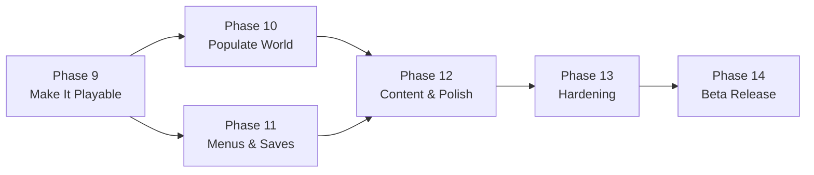

# Deencraft — Road to Beta Release

**Created:** 2026-08-01
**Status:** Active roadmap
**Goal:** A playable, stable, culturally-rich Deencraft beta running in Chrome via Firebase Hosting.

---

## 0. Executive Summary — Where the Project Actually Stands

Phases 1–8 of [deencraft-plan.md](deencraft-plan.md) are marked complete, and the **logic layer genuinely is**: ~66 C# files across 9 assemblies, with ~239 EditMode tests covering world gen, meshing, inventory, crafting, vitality, animal FSM, trading, auth models, and settings.

**But the game is not assembled.** The critical discovery from this audit:

> Deencraft is roughly **90% coded and 20% integrated**. Nearly every system exists as tested C# but is not wired into a scene, has no prefab, and cannot be reached by a player.

### Evidence

| Finding | Detail |
|---|---|
| **Only one scene exists** | [Main.slunity.unity](../Assets/Scenes/Main.slunity.unity) is the sole scene. [WebGLBuildConfig.cs](../Assets/Editor/WebGLBuildConfig.cs) references `Loading.unity`, `Auth.unity`, `Game.unity` — **none of which exist**. That build path is broken. |
| **Zero UI in the scene** | The scene contains no `Canvas` and no `EventSystem`. All 10 UI scripts (HUD, main menu, pause, settings, character customizer, world select, profile picker) are unreachable dead weight at runtime. |
| **Player is nearly bare** | The Player GameObject has only `PlayerController` + `CharacterController`. No `InventoryHolder`, `VitalitySystem`, `BlockInteractor`, `CharacterCustomizer`, or `PlayerAnimator`. The player **cannot mine, place, hold items, or take damage**. |
| **No prefabs at all** | [Assets/Prefabs/](../Assets/Prefabs/) contains only `.gitkeep`. Animals, villagers, and boats have no prefabs. |
| **No spawners exist** | No `AnimalSpawner` / `VillagerSpawner` class exists anywhere. `AnimalController`, `HorseController`, `VillagerAI`, and `BoatController` can never appear in the world. |
| **No custom WebGL template** | [WebGLBuildScript.cs](../Assets/Editor/WebGLBuildScript.cs) sets `template = "PROJECT:Deencraft"`, but no `Assets/WebGLTemplates/` folder exists — so the themed loading screen at [webgl-build/index.html](../webgl-build/index.html) is never used. |
| **Two competing interaction systems** | `BlockInteractionManager` (Phase 2 stub, always places Stone) still coexists with its replacement `BlockInteractor`. |
| **Villager trading is a stub** | `VillagerAI.Interact()` only logs a message; `TradeSession` logic is fully tested but never invoked. |
| **No PlayMode tests** | `PlayMode.asmdef` exists with zero tests — no integration coverage for the very wiring that is broken. |
| **Empty audio/art** | No music, no SFX, no adhan clips, no models. One block atlas + one vertex-color shader. |

### Live browser bug found during this session (fixed)

`PlayerController.Awake()` called `Shader.Find("Standard")`, which returns `null` in WebGL because engine code stripping removes that shader (nothing else in the project references it). `new Material(null)` threw `ArgumentNullException`, aborting `Awake()` mid-way and skipping camera creation — producing the **black screen with unresponsive input**. Fixed in [PlayerController.cs](../Assets/Scripts/Player/PlayerController.cs) by recoloring the primitive's default material instead. **Requires a rebuild to verify.**

### Guiding principle for this roadmap

> **Stop writing new systems. Start connecting the ones that exist.**

Phases 9–11 are pure integration — they turn existing tested code into a playable game. Only Phase 12 adds meaningful new content.

---

## Phase 9 — Make It Playable (CRITICAL PATH)  ✅ Code-complete — see `docs/phase_9_status.md`

**Goal:** A player loads the game in Chrome, spawns in the world, and can mine, place, and survive. No menus required yet.

**Why first:** Nothing else can be tested or judged until the core loop runs. This is the single highest-value phase in the project.

### 9.1 Verify the WebGL crash fix
- [x] Rebuild WebGL, serve locally, confirm no `ArgumentNullException: shader` in console
- [x] Confirm the player capsule renders and the camera follows
- [ ] Confirm WASD + mouse look respond — **needs manual playtest** (automated browser couldn't hold tab focus/Pointer Lock)

### 9.2 Add a `link.xml` to stop engine stripping
- [x] Create `Assets/link.xml` preserving `UnityEngine.PhysicsModule` (fixes `CapsuleCollider doesn't exist`)
- [x] Add "Standard" (and `DeenCraft/VertexColor`, `UI/Default`, `Sprites/Default`) to **Graphics → Always Included Shaders** (via `SceneAssembler.EnsureAlwaysIncludedShaders()`)
- [x] Rebuild; confirm collider/shader warnings are gone

### 9.3 Complete the Player GameObject
Attach to the Player in the scene, and wire Inspector references:
- [x] `InventoryHolder`
- [x] `VitalitySystem`
- [x] `BlockInteractor` (mine/place/interact)
- [x] `CharacterCustomizer`
- [x] `PlayerAnimator` (no-ops safely without an Animator)

### 9.4 Remove the duplicate interaction system
- [x] Delete `BlockInteractionManager.cs` (Phase 2 stub) — `BlockInteractor` supersedes it
- [x] Confirm no scene object still references it

### 9.5 Minimal in-world HUD
- [x] Add `Canvas` (Screen Space Overlay) + `EventSystem` to the scene
- [x] Build a hotbar strip (9 `HotbarSlotUI`), hearts row, hunger bar
- [x] Wire `HudController` to `VitalitySystem` + `Inventory`
- [x] Add a crosshair

### 9.6 Spawn safety
- [x] Verify spawn-protection freeze releases once the chunk below has loaded (code reviewed, unchanged)
- [x] Confirm the player never falls through the world on load (15s failsafe present)

**Exit criteria**
- [x] Load in Chrome → spawn on solid ground
- [ ] walk, jump, sprint, swim — **needs manual playtest**
- [ ] Left-click mines a block and it appears in the hotbar — **needs manual playtest**
- [ ] Right-click places the held block — **needs manual playtest**
- [ ] Hearts and hunger bar visibly update — **needs manual playtest**
- [x] Zero errors in the browser console

---

## Phase 10 — Populate the World

**Goal:** The world feels alive. Animals, villagers, and boats actually exist in it.

### 10.1 Create prefabs (primitive art is acceptable for beta)
- [ ] `Horse`, `Cat`, `Chicken`, `Cow`, `Sheep` — capsule/cube composites, distinct colors and sizes
- [ ] `Villager` — humanoid primitive composite
- [ ] `Boat` — flattened box
- [ ] Each with the correct controller script + `CharacterController` pre-wired

### 10.2 Build the spawner system (new code — justified)
- [ ] `EntitySpawner.cs` in `DeenCraft.World` — spawns entities as chunks load, despawns as they unload
- [ ] Density and biome rules in `GameConstants.cs` (no magic numbers)
- [ ] Cap concurrent entities for WebGL performance (suggest ≤ 40)
- [ ] Animals spawn on valid surface blocks only, never inside geometry or water
- [ ] Villagers spawn adjacent to generated village houses
- [ ] Boats spawn near riverside/oasis water

### 10.3 Activate the static boat block
- [ ] Replace `BlockType.Boat` (ID 18) placeholder with a real `BoatController` entity at chunk load

### 10.4 Verify entity interactions end-to-end
- [ ] E to mount/dismount a horse; steering works
- [ ] E to board/steer a boat
- [ ] Shear a sheep; confirm 60s wool regrow
- [ ] Animals follow when holding food, wander otherwise

**Exit criteria**
- Walking in any direction encounters animals within a reasonable distance
- A village is discoverable and populated with named villagers
- Horse and boat are both rideable
- Framerate holds ≥ 30 FPS in Chrome with entities active

---

## Phase 11 — Menus, Progression & Persistence

**Goal:** A child can pick a profile, customize a character, play, save, and return to the same world.

### 11.1 Scene architecture
- [ ] Create `MainMenu.unity` — **must be build index 0** (`PauseMenuController` assumes this)
- [ ] Keep `Main.slunity.unity` as the gameplay scene (consider renaming to `Game.unity`)
- [ ] Fix [WebGLBuildConfig.cs](../Assets/Editor/WebGLBuildConfig.cs) — its `BuildScenes` array points at three non-existent scenes
- [ ] Reconcile the two build scripts ([WebGLBuildScript.cs](../Assets/Editor/WebGLBuildScript.cs) vs `WebGLBuildConfig.cs`) — **keep one, delete the other**

### 11.2 Wire the menu flow
- [ ] Main menu → child profile picker → world select → gameplay
- [ ] Character customizer panel reachable on first play
- [ ] Credits panel

### 11.3 In-game panels
- [ ] Inventory screen (hotbar + 27-slot backpack, drag/click to move stacks)
- [ ] Crafting screen (3×3 grid + preview + result), bind to a key
- [ ] **Trade panel** — finally connect `VillagerAI.Interact()` to `TradeSession` (replaces the log-only stub)
- [ ] Pause menu (Esc) with Resume / Settings / Save & Quit
- [ ] Settings panel — create the `MasterMixer` AudioMixer asset with exposed `MusicVolume` / `SFXVolume` parameters

### 11.4 Persistence
- [ ] Extend `WorldSaveData` to persist inventory contents (structure exists, UI never wired)
- [ ] Persist and restore player health/hunger
- [ ] **Persist player-modified blocks** — currently only the seed is saved, so all building is lost on reload. This is a beta blocker.
- [ ] Verify auto-save on quit and on an interval

**Exit criteria**
- Full loop: launch → pick profile → customize → play → build something → save & quit → relaunch → **buildings and inventory are still there**
- Trading with a villager exchanges items correctly
- Crafting produces items from the recipe database

---

## Phase 12 — Content, Polish & Cultural Depth

**Goal:** Deliver on the Islamic identity that makes Deencraft distinct, and make it pleasant to look at and hear.

### 12.1 Deferred cultural items from Phase 6
- [ ] Water slide speed boost (needs collision handling — deferred from Phase 6)
- [ ] Villager name-tag rendering (Arabic/Islamic names already exist in `VillagerProfile`)
- [ ] Auto-place Palestinian stone arches in villages
- [ ] Auto-place crescent/star decor on mosque rooftops

### 12.2 Art pass
- [ ] Proper block textures in the atlas (currently vertex colors only)
- [ ] Distinguishable item icons for hotbar/inventory
- [ ] Kid-friendly font and color palette
- [ ] Improved skybox and lighting tuned to the day/night cycle

### 12.3 Audio
- [ ] Ambient background music (calm, culturally appropriate)
- [ ] SFX: mine, place, footstep, water, eat, craft, trade
- [ ] Bundle a default adhan clip (currently expects manual user files)
- [ ] Verify the parent-facing adhan toggle works

### 12.4 Character art
- [ ] Replace the placeholder capsule with a simple rigged humanoid
- [ ] Hijab/kufi meshes and clothing color swaps driven by `CharacterAppearance`
- [ ] Basic animation clips: idle, walk, run, jump, swim, mine

**Exit criteria**
- A newcomer can tell within seconds that this is an Islamic/Palestinian world
- No placeholder capsules visible in normal play
- Every significant action has audio feedback

---

## Phase 13 — Hardening, Performance & Security

**Goal:** It must not crash, must not lag, and must not leak other children's data.

### 13.1 PlayMode integration tests (fills the biggest test gap)
- [ ] Scene loads with all required singletons present
- [ ] Player spawns on solid ground
- [ ] Mine → inventory gain → place → world change
- [ ] Save → reload → world and inventory match
- [ ] Entity spawn/despawn across chunk boundaries

### 13.2 WebGL performance
- [ ] Profile in Chrome; hold ≥ 30 FPS (target from [copilot-instructions.md](../.github/copilot-instructions.md))
- [ ] Tune `_viewDistance` (currently 8) and `_poolSize` (200) — note pool should be ≥ (2×8+1)² = 289
- [ ] Reduce build size; target < 10s initial load
- [ ] Fix `webGLMemorySize: 32` in ProjectSettings vs the 256–512 MB the build scripts intend — these currently disagree
- [ ] Resolve the `INVALID_OPERATION: drawBuffers` and offscreen-FBO warnings seen in console

### 13.3 Firebase & security
- [ ] Create the real Firebase project (still not done — deferred since Phase 1)
- [ ] Deploy Firestore rules enforcing `auth.uid == parentUid` (deferred since Phase 7 — **a child must never read another family's saves**)
- [ ] Switch backend from `LocalFileBackend` to `FirebaseBackend`
- [ ] Confirm `firebase-config.json` stays gitignored and is never committed
- [ ] Re-verify PIN SHA-256 hashing and path-traversal protections under the Firebase backend

### 13.4 Error resilience
- [ ] Graceful UI message on network/auth failure (never a blank screen)
- [ ] Guard against save corruption (validate on load, fall back safely)

**Exit criteria**
- All EditMode + new PlayMode tests green
- ≥ 30 FPS, < 10s load in Chrome
- Firestore rules verified to block cross-account reads

---

## Phase 14 — Beta Release

**Goal:** Real children play it in Chrome.

### 14.1 Build pipeline
- [ ] Create `Assets/WebGLTemplates/Deencraft/` so the themed loading screen actually ships
- [ ] Align compression: build scripts request **Brotli**, ProjectSettings currently says **Gzip**, and the shipped build is `.gz` — pick one and make [firebase.json](../firebase.json) headers match
- [ ] Fix [firebase.json](../firebase.json) — its SPA rewrite (`** → /index.html`) can shadow build assets; scope it carefully
- [ ] Make [deploy.sh](../deploy.sh) a one-command reliable path (note: it currently has a stray trailing `` ` `` character)

### 14.2 Documented local testing
- [ ] Keep [webgl-build/serve.py](../webgl-build/serve.py) as the sanctioned local server — Python's default `http.server` does **not** send `Content-Encoding`, which breaks compressed builds
- [ ] Document the `127.0.0.1` vs `localhost` gotcha (IPv6 binding caused `ERR_CONNECTION_RESET` this session)

### 14.3 Cross-browser & device
- [ ] Chrome (primary target), then Safari, Firefox, Edge
- [ ] Tablet browser: viewport scaling and UI readability
- [ ] Decide explicitly whether touch controls are in or out of beta scope

### 14.4 Ship
- [ ] Deploy to Firebase Hosting
- [ ] Optional custom domain
- [ ] Parent-facing one-page guide (accounts, adhan toggle, safety)
- [ ] In-game feedback channel or bug-report link
- [ ] Small closed beta group first

**Exit criteria — the original [deencraft-plan.md](deencraft-plan.md) checklist, finally verifiable:**
- [ ] Loads in Chrome under 10s
- [ ] No framerate drops below 30 FPS
- [ ] Parent creates account, adds child, child logs in
- [ ] Child can mine, place, craft, eat, ride a horse, use a boat
- [ ] Character customization persists across sessions
- [ ] Village with a tradeable villager spawns
- [ ] All 5 biomes generate

---

## Priority Ordering

Phases 10 and 11 can run in parallel after Phase 9. Everything is blocked on Phase 9.

---

## Top 10 Beta Blockers (ranked)

| # | Blocker | Phase |
|---|---|---|
| 1 | Player cannot mine, place, or hold items (components not attached) | 9.3 |
| 2 | No UI exists in any scene — no HUD, no menus | 9.5 / 11 |
| 3 | Player-built blocks are **not saved** — all building is lost on reload | 11.4 |
| 4 | No entity spawners — animals, villagers, boats never appear | 10.2 |
| 5 | Build config references three scenes that do not exist | 11.1 |
| 6 | Firestore security rules never deployed — cross-account data risk | 13.3 |
| 7 | Villager trading is a log-only stub despite tested logic | 11.3 |
| 8 | Engine code stripping breaks colliders/shaders at runtime | 9.2 |
| 9 | Compression settings disagree across build scripts, ProjectSettings, and hosting | 14.1 |
| 10 | Zero PlayMode tests — integration is exactly what is broken | 13.1 |

---

## Methodology

Per [copilot-instructions.md](../.github/copilot-instructions.md), use the Superpowers skills:

- `brainstorming` before any genuinely new feature (Phase 10 spawners, Phase 12 art direction)
- `writing-plans` to expand each phase here into a task-level plan in `docs/superpowers/plans/`
- `test-driven-development` — write the failing test first, especially for the new PlayMode suite
- `systematic-debugging` — root-cause first, as was done for the `Shader.Find` black screen
- `verification-before-completion` — **no phase is complete without a rebuilt WebGL build loading cleanly in Chrome**

Write a `docs/phase_N_status.md` at the end of each phase, matching the existing format.

---

## Non-Goals (unchanged for v1/beta)

- No hostile mobs, combat, or violence of any kind
- No multiplayer (the ideas in [1-mob-feature.md](1-mob-feature.md) are v2 brainstorming, not beta scope)
- No in-app purchases
- No native mobile apps
- No modding support
